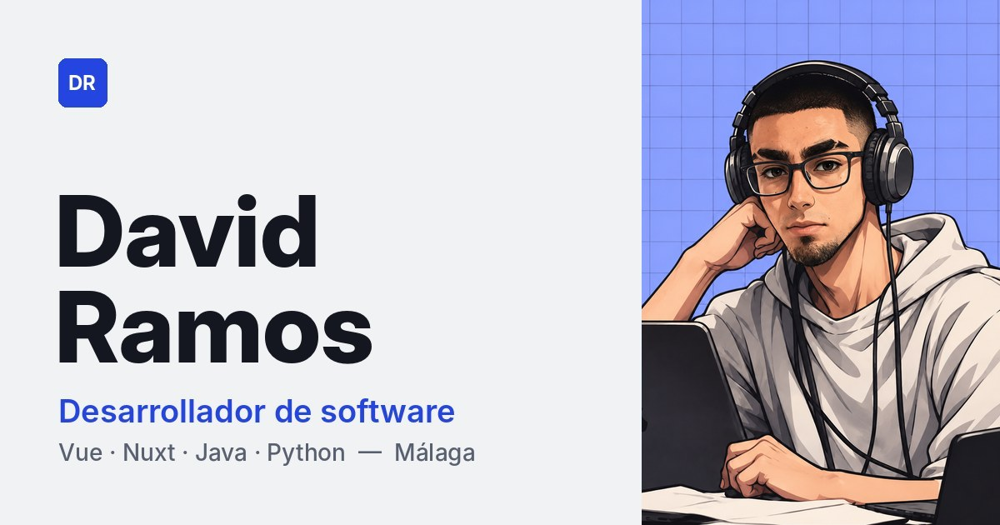

# Porfolio · David Ramos

🌐 **[davurg.dev](https://davurg.dev)**

Mi porfolio personal como desarrollador de software: trayectoria, proyectos, stack, certificaciones y contacto. Disponible en **español** (por defecto) e **inglés**.



## Tecnologías

- [Nuxt 3](https://nuxt.com) y Vue 3
- Tailwind CSS y CSS propio con variables (tema claro y oscuro)
- @nuxt/image y Pinia
- Formulario de contacto con [FormSubmit](https://formsubmit.co)

## Puesta en marcha

```bash
npm install
npm run dev        # http://localhost:3000
npm run build      # build de producción
npm run generate   # versión estática
```

## Dónde se cambia cada cosa

| Qué | Archivo |
| --- | --- |
| Textos, trayectoria, proyectos, stack y currículum | `data/portfolio.js` |
| Certificaciones | `data/certificaciones.js` |
| Texto de la política de privacidad | `data/privacidad.js` |
| Textos fijos de la interfaz (botones, títulos…) | `data/textos.js` |
| Lógica de idioma (ES/EN) | `composables/useIdioma.js` |
| Estilos globales y colores | `assets/css/main.css` |

Los textos traducibles se escriben así: `{ es: 'Hola', en: 'Hello' }`. Si se pone un texto normal, se muestra igual en los dos idiomas.

## Currículum en PDF

`public/CV_david.pdf` (español) y `public/CV_david_en.pdf` (inglés) se generan a partir de `data/portfolio.js`:

```bash
node scripts/generar-cv.mjs
```

Después se abren `scripts/cv_es.html` y `scripts/cv_en.html` en Chrome y se imprimen a PDF (A4, márgenes: ninguno, sin encabezados ni pies de página).

## Contacto

- LinkedIn: [David Ramos García](https://www.linkedin.com/in/david-ramos-garcia-a76686308/)
- Email: ramosdavu2006@gmail.com
